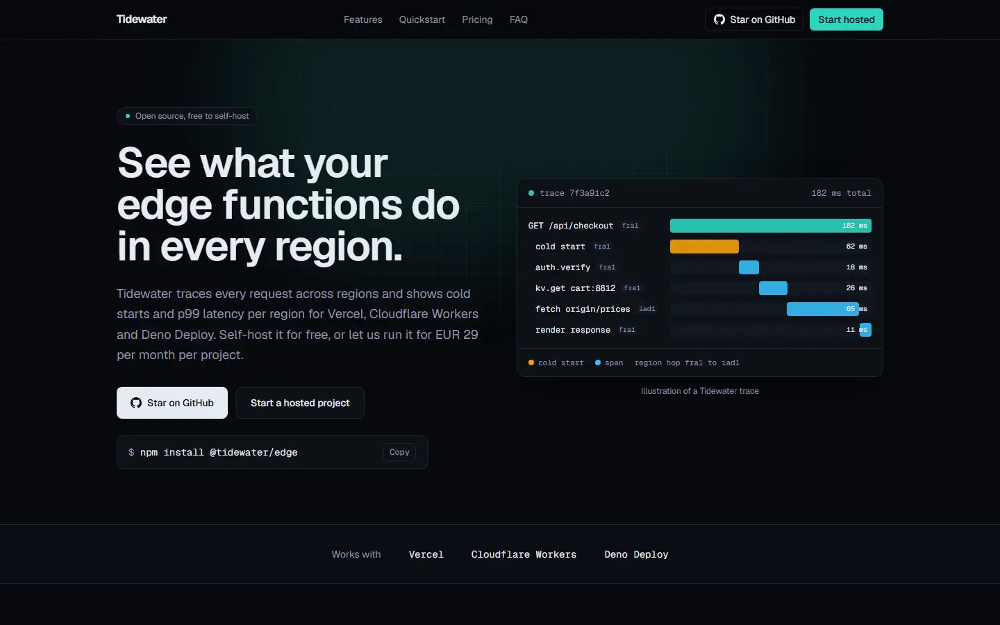
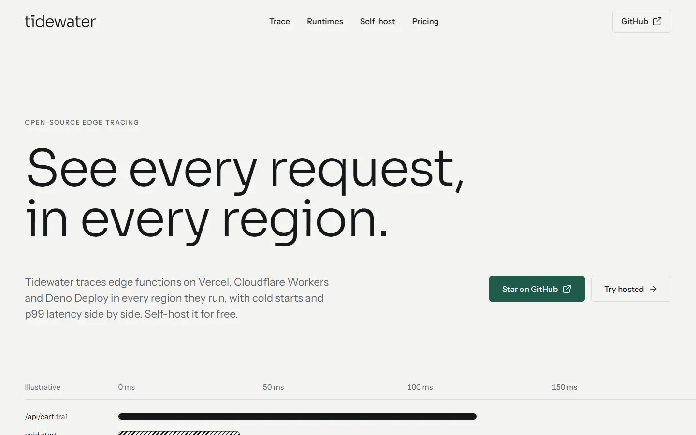
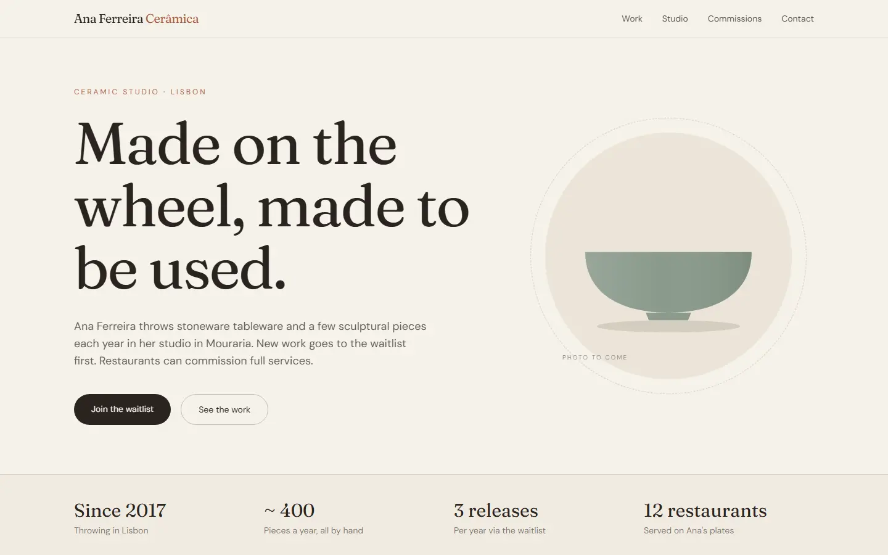
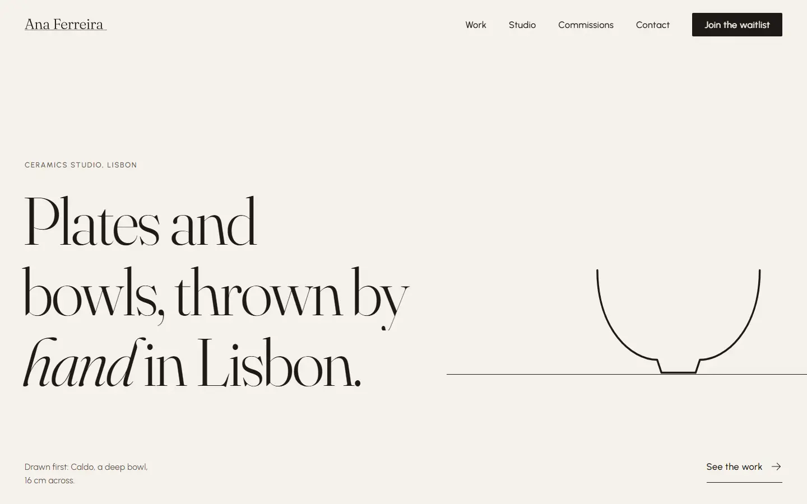
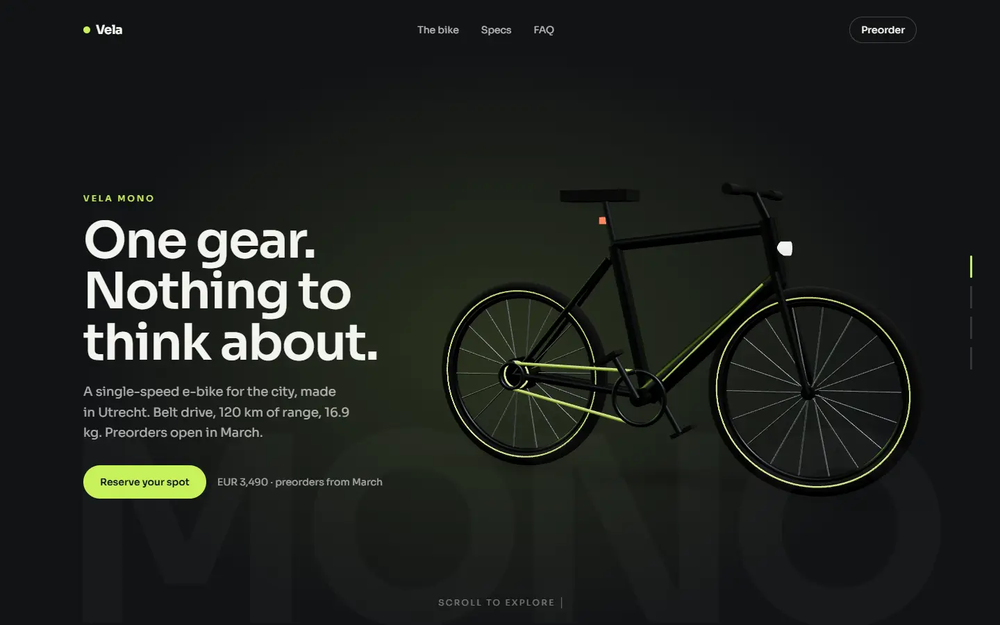
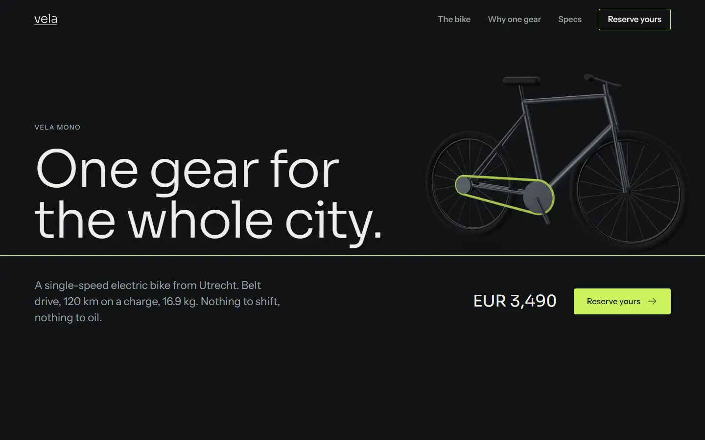

# Struq

**Award-tier web design for your coding agent.**

Struq is a design skill for Claude Code, Codex, Cursor and OpenCode. Give it a brief and it builds a cinematic, agency-grade site: the kind with large light type, a restrained palette, smooth scroll, masked reveals, a pinned showpiece, full-screen page transitions and, where it earns its place, a 3D moment. It ships the decisions an award-winning studio makes, in the order they make them, on the stack they use.

The icon set the skill uses by default, Struq Icons, is browsable at [struq.nl/iconen](https://struq.nl/iconen).

```bash
npx @struq/skill@latest
```

It finds the AI tools on your machine and installs the skill into each of them. Then, in your agent:

```text
/struq a portfolio for an architecture studio in Rotterdam, dark, calm, lots of photography
```

| Agent | How to invoke |
|---|---|
| Claude Code (installed with `npx @struq/skill` or `npx skills`) | `/struq <brief>` |
| Claude Code (installed as a plugin) | `/struq:struq <brief>` |
| Codex | `$struq <brief>` |
| Cursor | invoke the struq skill by name: "use the struq skill to build ..." |
| OpenCode | invoke the struq skill by name: "use the struq skill to build ..." |

## Same brief, with and without Struq

Three briefs, each built twice by the same model with the same materials: once as a plain coding agent, once with `/struq`. An independent reviewer then scored all six sites **blind**, from screenshots only, without knowing which side used the skill.

| Brief | Without | With Struq | Invented facts (without / with) | Template tells (without / with) |
|---|---|---|---|---|
| Ceramicist portfolio, no logo, no photos | 56 | **79** | 14 / 5 | 6 / 3 |
| E-bike launch, existing brand, wants 3D | 66 | **76** | 11 / 3 | 6 / 3 |
| Open-source dev-tool landing page | 50 | **76** | 11 / 2 | 10 / 2 |
| **Average** | **57** | **77** | **36 / 10** | **22 / 8** |

Scored out of 100 on typography, composition, color, concept, motion, content honesty, craft and distinctiveness. "Invented facts" counts claims the brief never gave: quotes, bios, stats, specs, API names.

**Dev-tool landing page.** Without: the dark developer-tool template, item for item. With: a light page built around a trace waterfall that assembles as you scroll.

| Without | With Struq |
|---|---|
|  |  |

**Ceramicist portfolio.** Without: a tidy template with a stat strip, a chef quote and a bio the brief never supplied. With: a single-line profile drawing of each piece stands in for the missing photos and becomes the site's motif.

| Without | With Struq |
|---|---|
|  |  |

**E-bike launch.** The closest pair: both built a pinned 3D bike. Without: a spec sheet the brand never published. With: the lime belt as the one motif, and unknown specs openly held back.

| Without | With Struq |
|---|---|
|  |  |

Where Struq lost points: craft. The plain builds are less ambitious and break less; the Struq builds had reveal states that rendered empty in some captures. That is the next thing being fixed.

## What you get

**One recipe, fixed on purpose.** The expensive feel comes from these pieces sharing one animation clock, not from any single effect.

| Layer | Tooling |
|---|---|
| Typography | Two faces from the Signature pairing set, set through role tokens. Display runs large and light (300 to 400). A fluid scale, one typographic signature move per site, SplitText choreography. |
| Palette | Temperature-shifted neutrals, one accent, light and dark surface ladders |
| Scroll | Lenis on the GSAP ticker, ScrollTrigger scrub, masked reveals, never opacity-only fades |
| Showpieces | 23 named recipes, each tagged showpiece or system: pinned scrub timelines, horizontal galleries, sticky stacks, path journeys, manifesto fills |
| SVG | DrawSVG and MorphSVG: self-drawing marks, logo morphs, scroll-drawn paths |
| Pointer | Magnetic buttons, cursor followers, hover scenes, image distortion |
| Page flow | Full-screen cover, swap and reveal route transitions, session-gated loaders, Radix overlay menus |
| 3D | Three.js, React Three Fiber, Drei and postprocessing as lazy islands with poster fallbacks |
| Direction | A directed mode for full WebGL experiences: chapters, camera shots, handoffs, ownership |

Stack: Next.js App Router and Tailwind by default, Vite supported. It reads the versions your project has installed and adapts to them; nothing is pinned. Every GSAP plugin used is free on npm. Icons: [Struq Icons](https://struq.nl/iconen) (`@struq/icons`, MIT) by default.

## Commands

| Command | What it does |
|---|---|
| `/struq <brief>` | Plans the site into one `STRUQ.md`, stops once for your veto, builds it, then screenshots it at 390, 768, 1440 and 1920 and fixes what it sees |
| `/struq redesign <path>` | Keeps your brand, copy and components; rebuilds the execution |
| `/struq audit <path-or-url>` | Changes nothing. Returns a score out of 100, every tell with its fix, and the three highest-payoff changes |
| `/struq direct <brief>` | Directed mode for one continuous 3D experience across chapters |

In Codex, use `$struq` instead of `/struq`; as a Claude Code plugin the command is `/struq:struq`.

## How a build runs

1. **Plan.** It reads your brief and writes one `STRUQ.md`: brand, concept, the two typefaces, palette tokens, icon family, page arc, which showcase recipes go where, the transition system, and whether 3D is warranted. It never invents testimonials or stats.
2. **One stop.** It shows the summary and asks once: veto anything, and send a logo, photos or real numbers if you have them. Only an empty or vague brief gets a short wizard first.
3. **Build.** Static layout to the baseline first, at desktop and mobile at once. Motion goes on in layers: reveals, composition, showpieces, text and SVG, pointer, then 3D.
4. **Look.** Screenshots at four widths, a tell scan, a feel audit and one full scroll. Then it fixes and re-shoots.

## Install options

```bash
# every AI tool on this machine: Claude Code, Cursor, Codex, OpenCode, Gemini CLI, Copilot, Windsurf
npx @struq/skill@latest

# one tool only, or into the current project instead of your home folder
npx @struq/skill@latest --claude
npx @struq/skill@latest --project
```

Run it again to update, and `npx @struq/skill@latest remove` to take it out.

With the open skills CLI, which knows 70+ agents:

```bash
npx skills add struqnl/struq-design -g
```

As a Claude Code plugin (the command is then `/struq:struq`):

```text
/plugin marketplace add struqnl/struq-design
/plugin install struq@struq
```

Node 18+ is required. The screenshot step uses whatever browser tool your agent has (Playwright or similar).

## Struq Icons

Struq builds use [Struq Icons](https://struq.nl/iconen) by default: 182 two-tone icons, most with their own hover motion, MIT.

```bash
npm install @struq/icons
```

## What it fetches and sends

Struq is instructions and reference files. It runs no code of its own and collects or sends nothing about you or your project.

- **Photos, only when your brief has none.** The skill has your agent read the public pack list at `https://struq.nl/api/media/packs` and download the chosen images from `https://struq.nl/media/packs/` into your project. These are plain public requests: no account, no key, and nothing from your project goes with them. The images are CC0.
- **Checks.** The screenshot and performance checks run against your own local dev server, with your agent's own browser tool.
- **The installer.** `npx @struq/skill@latest` downloads the package from npm, looks for the AI tools' folders in your home folder and copies the skill into them. It sends nothing.

## License

MIT
